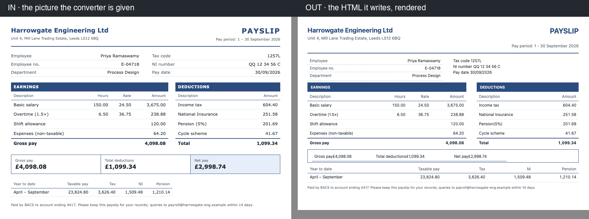
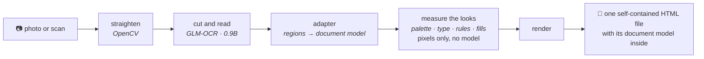
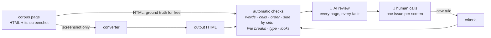

# doc-to-html

**A photo of a document in. Faithful, editable HTML out. Small models, all local.**


> **A toy-scale experiment, on purpose.** Can **very small models**, wrapped
> in a **carefully engineered harness**, turn any document picture into
> **valid** HTML **entirely on a laptop**? The code is written **with AI
> coding tools**. What counts as *valid* is decided **by a human**.



<sub>A payslip from the development corpus, converted on an 8 GB M1 by the
current pipeline (2026-11-09). Both tables are real `<table>`s, and the
colours, rules and type sizes are measured from the pixels. **It is not
perfect, and the project says so:** the summary box's labels and amounts run
together, and the tax-code block has lost its right-aligned values.</sub>

---

## The manifesto

| | |
|---|---|
| 🧠 **Very small models** | A 0.9B-parameter OCR parser ([GLM-OCR](https://github.com/zai-org/GLM-OCR)), a 4B vision-language model (`qwen3-vl:4b`) and an ONNX layout detector. All run locally through [Ollama](https://ollama.com) on an 8 GB laptop, and nothing leaves the machine. |
| 🛠️ **The harness does the heavy lifting** | It straightens the photo, finds the regions and asks each model one narrow question about one crop. It checks the arithmetic, measures colours, rules and type sizes from the pixels (no model), and writes real HTML. |
| 🤖 **AI-assisted code** | The code, the corpus and the reviews are written with an AI coding agent ([Claude Code](https://claude.com/claude-code)). It works from one spec per piece of work, and its standing instructions are [`CLAUDE.md`](CLAUDE.md). |
| 👤 **Human-driven validation** | A human sets the target and judges by eye. **Nine review rounds and 91 decisions** have become the [criteria](docs/agents/review-criteria.md) that the automatic checks enforce. |

**"Valid" means three things, in this order:**
1. **every word and number as printed**, none lost and none invented;
2. **the structure kept**: a table is a `<table>`, and side by side stays side by side;
3. **it looks like the page**: the ground, the colours, the type sizes and the rules.

It does not mean a pixel copy: the output is semantic HTML that you can edit.

---

## How it works



**Two pipelines, measured against each other** on 41 pages that neither had
ever seen:

| | **v1: a VLM per region** (Jul–Oct) | **v2: parser first** (Nov, adopted) |
|---|---|---|
| finds the regions | Docling's Heron detector (ONNX) | GLM-OCR's layout model |
| reads them | `qwen3-vl:4b`, asked about one crop at a time | GLM-OCR, 0.9B |
| draws them | measured looks, then the renderer | the same, shared |
| **time for the 41 pages** | **6.6 h**, and 4 pages over the 20-min limit | **18 min**, none over the limit |
| judged by eye, page by page | — | **13 better · 7 worse · 17 the same**, and the 4 v1 lost converted |
| major faults per page (the 37 both converted) | 17.6 | 17.8 |

**An honest status:** both pipelines still make at least one major fault on
every unseen page. v2 was adopted on 2026-11-09 because it reads more of
these pages correctly, about 22× faster. The faults it leaves are mostly
the harness's own, which is where the work goes next.

---

## How "valid" is measured



- **The ground truth costs nothing to make.** Every corpus page is an HTML
  file plus its screenshot. The converter sees only the screenshot, and
  the checks compare the two HTMLs as headless Chrome lays them out.
- **The corpus is built by variability, not by convenience.** 631 pages
  in eight families of documents (forms, receipts, reports, letters…)
  plus fragments, mostly in Latin-script languages:
  - 573 written by AI agents from randomly drawn spec cards;
  - 27 real PDF pages, each with an HTML twin that a gate admits;
  - 31 written by hand.
- **The corpus is split for honest evaluation.** *dev* (231) is for
  development, *panel* (200) for measurement, and the *vault* (200) is
  sealed in code and opened only at milestones.
- **Every number can be reproduced.** The models run at temperature 0,
  every model answer is recorded, and replaying the answers rebuilds a
  frozen baseline byte for byte.
- **The human decides, and the AI does the legwork.** Claude reviews
  every page against the agreed criteria. The human spot-checks the
  calls and settles every disagreement, one issue per screen. Each
  decision becomes a rule and a test.

---

## What to look at as an engineer

| | |
|---|---|
| **One spec per piece of work** | 23 so far ([`docs/specs/`](docs/specs/)). Each holds its question, its measurements, what was tried and rejected, and the decision. |
| **Decision records** | Five ADRs ([`docs/adr/`](docs/adr/)), such as [no document types](docs/adr/0001-no-document-types.md) and [style is measured from the pixels](docs/adr/0005-style-is-measured-from-the-pixels.md). |
| **Lessons that generalise** | In [`CLAUDE.md`](CLAUDE.md): a metric that saturated and then inverted, a flag that never reached its code, a guard that created the fault it looked like. |
| **Tests** | 1721, with `mypy` clean. Recorded model answers let the suite run with no model at all. |
| **The live state** | [`docs/status.md`](docs/status.md), and the plan in [`docs/level-up.md`](docs/level-up.md). |

### Repository map

| path | what |
|---|---|
| [`src/doc_to_html/`](src/doc_to_html/) | the converter: `ir.py` (the document model), `preprocess.py` (straightening), `adapter.py` + `parser_first.py` (v2), `orchestrator.py` (v1), `style.py` and `looks.py` (measured looks), `render.py`, `checks.py` (the validity checks) |
| [`tools/`](tools/) | command-line tools: batch runs, measurement, review sheets, replay |
| [`corpus/`](corpus/) | the 631-page corpus: cards, the manifest and the checks |
| [`tests/`](tests/) | the suite, and `tests/frozen/`: frozen baselines with the answers that made them |
| [`docs/`](docs/) | specs, ADRs, the status, the review criteria. [`docs/README.md`](docs/README.md) is the map. |
| [`CONTEXT.md`](CONTEXT.md) | the vocabulary the code uses: Zone, Band, Kind, Probe… |

---

## Try it

```bash
uv venv && uv pip install -e '.[dev,detector,tesseract]'
pytest                    # no model needed; headless Chrome for the projection tests
```

With [Ollama](https://ollama.com) running and `qwen3-vl:4b` pulled, run v1:

```bash
python tools/fetch_layout_models.py     # the ONNX layout detector
doc-to-html convert example/invoice.png -o invoice.html
```

v2 runs the parser in its own environment (`~/.venvs/glmocr` with
`glmocr[selfhosted]`, and `glm-ocr` on Ollama). The setup is in
[spec 0023](docs/specs/0023-parser-first.md). Then:

```bash
python tools/d2.py demo --pages probe_payslip --parse --sheets
```

---

## The story so far, month by month

| month | milestone | takeaway |
|---|---|---|
| **Jul 2026** | **The skeleton.** The document model, arithmetic checks ("does this column sum to its total?"), a renderer, one extractor per kind of content, straightening of photographs, a bake-off of local models. | Ask a small model about **one region's own crop**, never the whole page shrunk down: it reads what it can see. One 4B model serves every step. |
| **Aug 2026** | **Geometry.** Boxes snapped to their ink. Then the VLM's layout pass was replaced by a trained ONNX detector. | A change can **pass its own gate and still cost the document**. Judge the whole page, not only the fields a change was meant to move. |
| **Sep 2026** | **The metric that lied.** The score against hand-typed references reported a *full match* for a table that had lost all five column headers. It improved 23 → 10 while duplicated titles appeared in three of five documents. On 2026-09-17 the target became *the render looks and reads like the page*, and the ground truth became the HTML and its screenshot. | **Look at the artefact, not only the number.** A metric can saturate, then invert, and nothing inside it will tell you. |
| **Oct 2026** | **By eye, then a step back.** Twelve specs, each closed by a full sweep of the corpus (15 documents, then 21) and judged by eye from mid-month. Each baseline is frozen and replayable byte for byte. Then a probe on ten pages it had never seen found a structural fault on 9 of 10, against 0 of 6 tuned pages. A new plan followed: a 631-page corpus built by variability, with sealed held-out pools. | **Pages you tuned on cannot tell you about the next one.** Generalisation has to be measured on pages nobody has looked at. |
| **Nov 2026** | **Honest numbers and a pivot.** Automatic checks plus an AI reviewer, held to criteria the human set in nine rounds. The honest baseline found a major fault on every one of 37 unseen pages, in 6.6 h. A parser-first proof of concept with a 0.9B OCR model took 18 min, was better on 13 pages and worse on 7, and was **adopted** on 2026-11-09. | **A small specialised parser beat the hand-assembled reading pipeline** on unseen pages. The harness's value moves to what the parser cannot do: measuring the looks, checking, rendering. |

**Next:** fix the harness's own faults on the parser's output, each one
reproduced on a development page first. Then fit the remaining hand-set
constants from data rather than tuning them by hand.

---

<sub>MIT licensed. Every model runs locally, and no document leaves the
machine.</sub>
